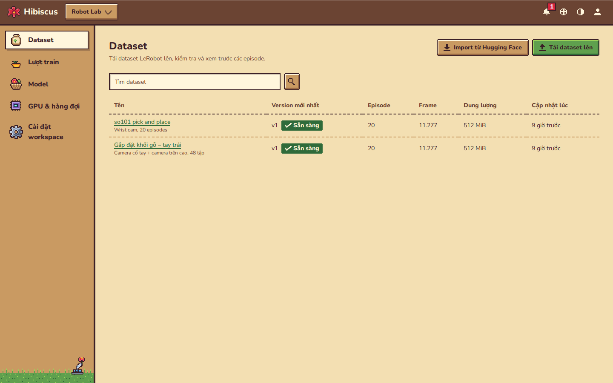
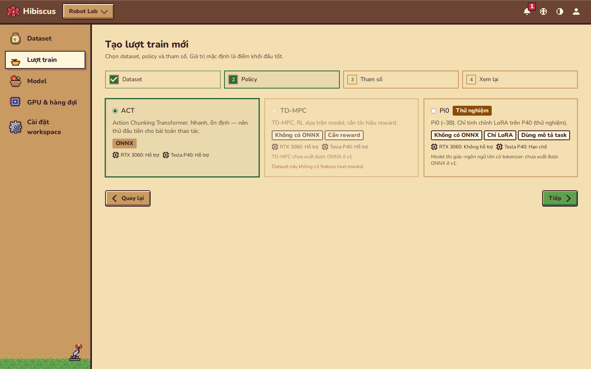
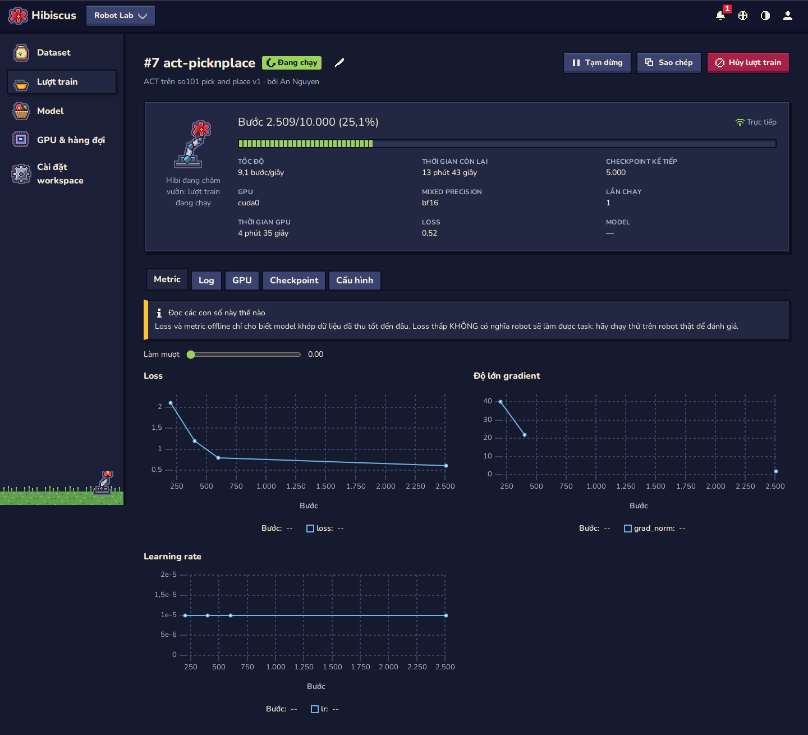
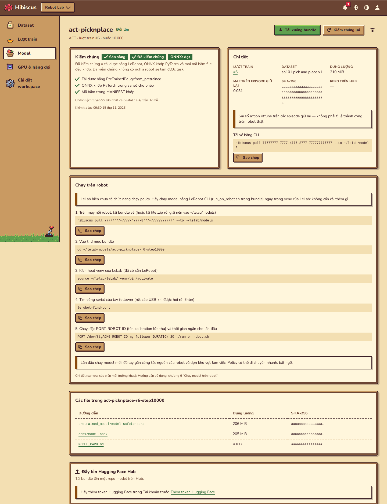
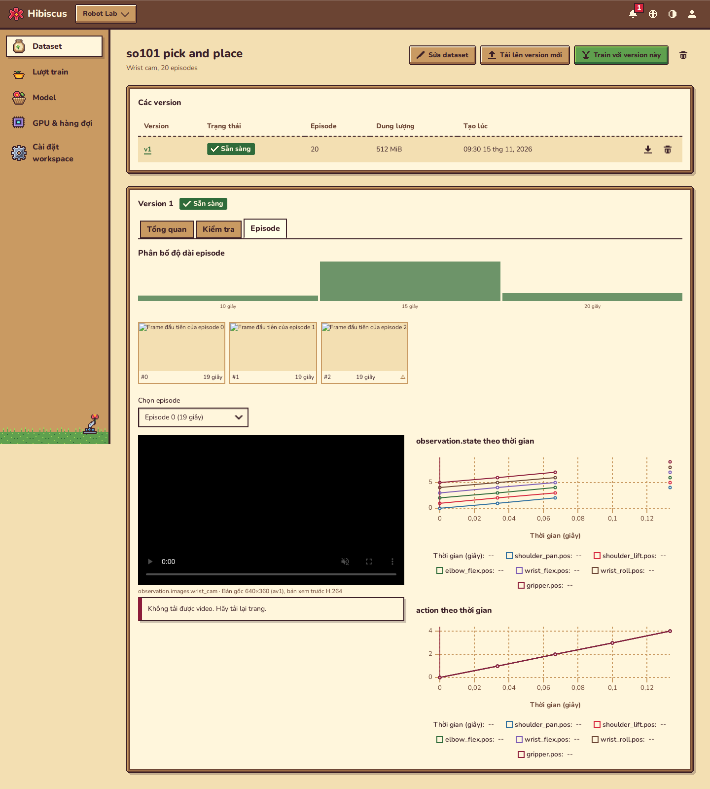
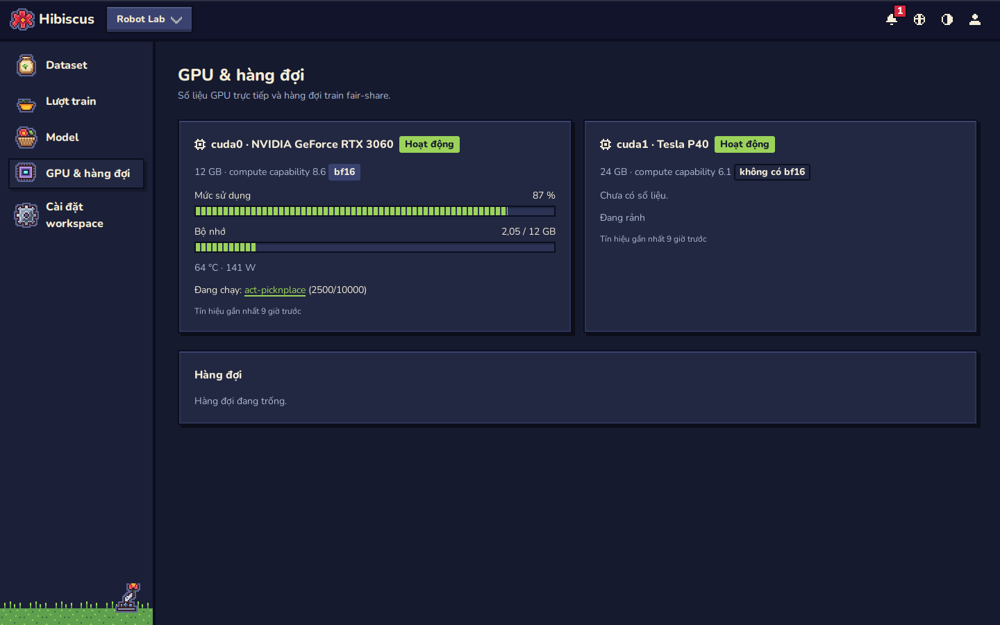
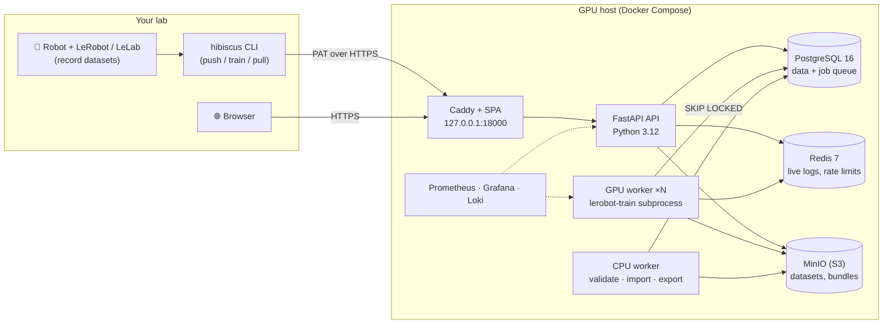
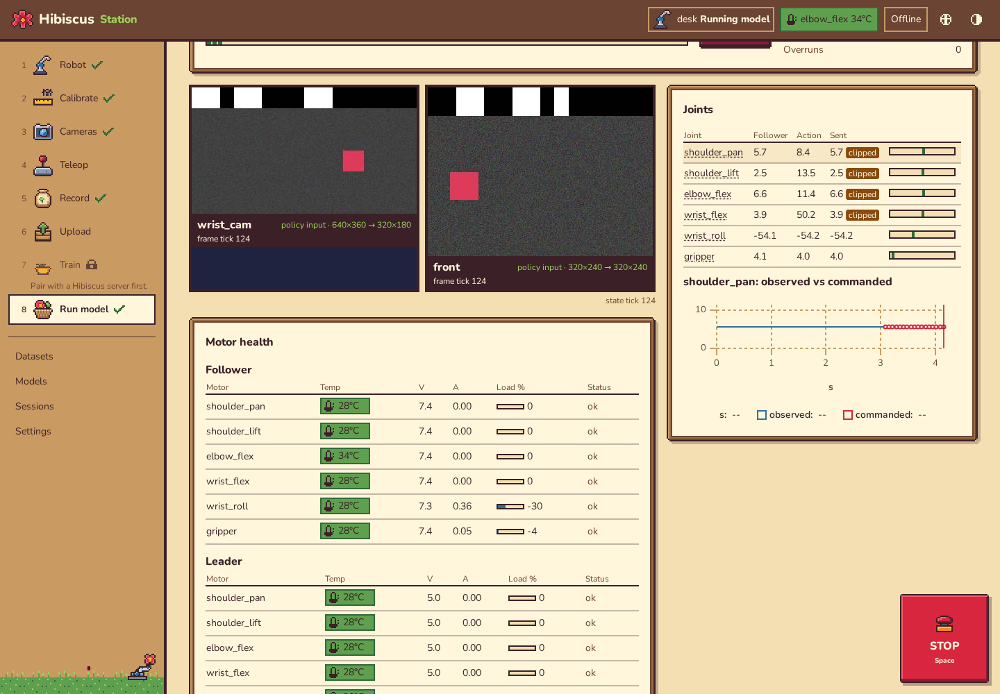

<div align="center">

<a href="https://github.com/Bigkatoan/Hibiscus">
  <picture>
    <source media="(prefers-color-scheme: dark)" srcset="assets/brand/banner-dark.png">
    <source media="(prefers-color-scheme: light)" srcset="assets/brand/banner-light.png">
    
  </picture>
</a>

**English** · [Tiếng Việt](README.vi.md)

[](https://github.com/Bigkatoan/Hibiscus/actions/workflows/ci.yml)
[](https://github.com/Bigkatoan/Hibiscus/actions/workflows/codeql.yml)
[](LICENSE)
[](https://www.python.org/downloads/release/python-3120/)
[](https://github.com/Bigkatoan?tab=packages&repo_name=Hibiscus)
[](https://bigkatoan.github.io/Hibiscus/)
[](https://github.com/huggingface/lerobot)

</div>

**Hibiscus** is a self-hosted training platform for [LeRobot](https://github.com/huggingface/lerobot)
policies. Push the datasets you recorded next to your robot, pick a policy (ACT, Diffusion,
SmolVLA, π0 …) in a guided wizard, watch the run live on your own GPUs, and get back a verified
**model bundle**: a standard LeRobot `pretrained_model/` you can run with `lerobot-rollout`
straight away, plus ONNX exports, offline evaluation and a model card. It is a team tool: workspaces,
fair-share GPU scheduling, 2FA and audit logs come built in. And it is dressed as a pixel-art robot
garden, because watching a loss curve should feel like watching your garden grow. 🌺

## Gallery

<table>
  <tr>
    <td width="50%"><br><sub><b>Datasets</b>: resumable upload, deep validation, preview</sub></td>
    <td width="50%"><br><sub><b>Train wizard</b>: dataset → policy → hyper-parameters → review</sub></td>
  </tr>
  <tr>
    <td width="50%"><br><sub><b>Live run</b>: metrics over SSE, GPU telemetry, raw logs (night theme)</sub></td>
    <td width="50%"><br><sub><b>Harvest</b>: verified bundle, ONNX parity, offline eval</sub></td>
  </tr>
  <tr>
    <td width="50%"><br><sub><b>Episode viewer</b>: video + joint plots per episode</sub></td>
    <td width="50%"><br><sub><b>Greenhouse</b>: GPUs, queue and fair-share</sub></td>
  </tr>
</table>

More screenshots (light, dark, mobile) live in [`docs/ux/screenshots/pixel/`](docs/ux/screenshots/pixel/).

## Quick start

You need a Linux host with Docker Compose v2 and, for training, an NVIDIA GPU with the
[NVIDIA Container Toolkit](https://docs.nvidia.com/datacenter/cloud-native/container-toolkit/).

```bash
git clone https://github.com/Bigkatoan/Hibiscus.git && cd Hibiscus
cp deploy/.env.example deploy/.env && deploy/scripts/gen-secrets.sh >> deploy/.env   # then review deploy/.env
docker compose -f deploy/docker-compose.yml up -d --build --wait
```

Open <http://127.0.0.1:18000> and create the first admin account. The stack only listens on
loopback; put it behind a tunnel or reverse proxy of your choice to reach it from other machines
([install guide](docs/runbook/install.md), [Cloudflare Tunnel](docs/runbook/cloudflare.md)). The
default compose file starts one worker per GPU (`HIBISCUS_GPU0_DEVICE`, `HIBISCUS_GPU1_DEVICE`); see
[GPU workers](docs/runbook/gpu.md) to run with one GPU or a different card mix. `make help` lists
every operator shortcut (backups, upgrades, logs).

## Features

| | |
|---|---|
| 🌱 **Datasets** | Resumable chunked upload (folder, zip, tar, tar.zst, RAR5) from the browser or CLI, import from the Hugging Face Hub, deep LeRobot v3.0 validation, immutable versions, episode preview with video and joint plots. |
| 🪴 **Training** | 4-step wizard with forms generated from LeRobot's own config dataclasses (so new LeRobot options show up without hand-written UI), presets, VRAM/time estimate, pre-flight checks (camera keys vs. policy features), pause / resume / cancel / clone. |
| 📈 **Live monitoring** | Loss, L1, KLD, grad-norm, LR, throughput over SSE; NVML GPU telemetry; searchable raw logs; NaN / OOM / hang detection; multi-run comparison; email and webhook notifications. |
| 🧺 **Model bundles** | Unmodified `lerobot-train` output in `pretrained_model/`, ONNX export with a parity report, offline held-out evaluation, generated `run_on_robot.sh`, `MODEL_CARD.md`, sha256 `MANIFEST.json`, optional push to the Hub. |
| 🏡 **Teams** | Workspaces, RBAC, invitations, personal access tokens with scopes, fair-share GPU queue (Postgres `SKIP LOCKED`), per-user quotas. |
| 🔒 **Security** | Argon2id passwords, TOTP 2FA + recovery codes, session management, audit log, rate limits, OWASP ASVS L2 as the target; loopback-only ports by policy. |
| 🔭 **Operations** | One Docker Compose file, Prometheus + Grafana + Loki dashboards, nightly Postgres backups with restore drills, upgrade runbooks. |
| 🤖 **Hibiscus Station** | Local robot-side app (`uvx hibiscus-station` or `hibiscus station`): connect → calibrate → cameras → teleop → record a LeRobot dataset → upload → pull a model → run it on the robot, with motor temperature / voltage / current telemetry, thermal auto-stop and live camera previews. [Details below](#hibiscus-station). |
| 🧑‍🌾 **Bilingual UI** | Vietnamese and English throughout, accessible pixel-art theme (WCAG 2.1 AA, day and night modes). |

## Supported policies

Hibiscus trains with the **unmodified** `lerobot-train` of LeRobot **0.7.1**, so a bundle behaves exactly like
a checkpoint you trained yourself.

| Policy | Train | ONNX export | Notes |
|---|:-:|:-:|---|
| ACT | ✅ | ✅ full | the fast default; ~1.8 GB VRAM at batch 8 |
| Diffusion Policy | ✅ | ✅ UNet + denoise loop in `infer_onnx.py` | |
| VQ-BeT | ✅ | — | ONNX planned |
| TD-MPC | ✅ | — | |
| SmolVLA | ✅ | — | ~450M params; bf16 on Ampere+, fp32 on older cards |
| π0 / π0.5 | ✅ LoRA/PEFT | — | ~3B params; needs ≥ 24 GB VRAM, full fine-tune is blocked in the UI |

## Architecture



Every architecture decision is recorded as an ADR in [`docs/adr/`](docs/adr/); the HTTP contract is
[`api/openapi.yaml`](api/openapi.yaml) (OpenAPI 3.1) and both the web client and the CLI are generated
from it.

## CLI

The `hibiscus` CLI runs on the collection machine next to the robot (Python ≥ 3.10, no torch or
LeRobot needed) and talks to the server with a personal access token.

```bash
uv tool install ./cli                               # or: pipx install ./cli
hibiscus login --server https://hibiscus.example.com  # paste a token from Settings → Tokens
hibiscus push ~/lerobot_data/so101_picknplace        # resumable upload of a folder or archive
hibiscus watch ~/lerobot_data                        # auto-upload every finished recording
hibiscus train -d so101_picknplace -p act --preset standard -f   # queue a run and follow it
hibiscus logs -f '#42'                               # live logs (SSE, auto-reconnect)
hibiscus pull <model> --to ~/models                  # download + verify every sha256
hibiscus station --mock                              # launch Hibiscus Station (args go to hibiscus-station)
```

Full reference: [`cli/README.md`](cli/README.md).

## The model bundle, and running it on a robot

```
so101_picknplace_act-r42-step100000/
├── pretrained_model/        # standard LeRobot output → --policy.path
├── onnx/                    # model.onnx, io_spec.json, normalization.json, parity_report.json, infer_onnx.py
├── eval/                    # held-out offline metrics + plots
├── logs/                    # train.log, metrics.csv
├── run_on_robot.sh          # lerobot-rollout command pre-filled from your dataset
├── MODEL_CARD.md
└── MANIFEST.json            # sha256 of every file, software versions, dataset@version
```

A bundle is only marked **verified** when it loads with `PreTrainedPolicy.from_pretrained`, the ONNX
parity check passes, and the manifest hashes match. To run it, use any environment that has
LeRobot 0.7.1 installed (for example the virtualenv of your LeLab install):

```bash
hibiscus pull so101_picknplace_act --to ~/models && cd ~/models/so101_picknplace_act-r42-step100000
source ~/lelab/leLab/.venv/bin/activate            # any venv with lerobot==0.7.1
PORT=/dev/ttyACM0 ROBOT_ID=my_follower WRIST_CAM=0 DURATION=20 ./run_on_robot.sh
```

`run_on_robot.sh` wraps `lerobot-rollout --policy.path=./pretrained_model` with the robot type, fps,
camera names and task taken from your dataset, so you only fill in ports. Keep a hand near the power
switch the first time. Details: [Running a model on the robot](docs/user-guide/en/06-run-on-robot.md).

## Hibiscus Station

Hibiscus Station is the robot-side half of Hibiscus: a small local web app (FastAPI on loopback, same
pixel UI) that runs on the machine wired to the robot and walks the whole loop in one place.

<p align="center"><br><sub><b>Run model</b>: live camera previews and per-motor telemetry while a policy drives the arm</sub></p>

1. **Connect** the SO-100 / SO-101 follower and leader arms (serial ports are auto-detected).
2. **Calibrate** the motors, then set up and preview the **cameras**.
3. **Teleoperate** and **record** a LeRobot v3.0 dataset, episode by episode.
4. **Upload** it to your Hibiscus server, train there, then **pull** the verified model bundle back.
5. **Run** the model on the robot, with live camera previews.

Throughout, it streams motor temperature, voltage and current and **stops the arm automatically** when
a motor overheats.

```bash
uvx hibiscus-station                 # no install; or: uv tool install hibiscus-station
hibiscus station --mock --no-browser # through the CLI, here with simulated hardware
```

> **Status:** Hibiscus Station has been tested end to end against mock hardware and a real trained ACT
> checkpoint. It has **not yet been validated on real SO-101 hardware**, so treat it as a preview and
> keep a hand on the power switch.

Spec: [`docs/spec/station.md`](docs/spec/station.md) · usage and development: [`station/README.md`](station/README.md).

## Documentation

* 📘 **Docs site**: <https://bigkatoan.github.io/Hibiscus/> (English + Tiếng Việt)
* User guide: [English](docs/user-guide/en/01-getting-started.md) · [Tiếng Việt](docs/user-guide/vi/01-bat-dau.md)
* Self-hosting runbooks: [`docs/runbook/`](docs/runbook/README.md)
* Specs: [bundle format](docs/spec/bundle.md), [run lifecycle](docs/spec/run-lifecycle.md), [policy schema](docs/spec/policy-schema.md), [Hibiscus Station](docs/spec/station.md)

## Roadmap

- [x] **v0.1 Hibiscus Trainer**: datasets, training, live metrics, bundles, teams, CLI, pixel UI
- [x] **Hibiscus Station** (preview): robot setup, motor calibration, cameras, teleoperation and
      dataset recording in the same pixel UI, upload / pull, and running a policy with live motor
      telemetry, thermal auto-stop and camera feeds ([details](#hibiscus-station))
- [ ] 🚧 Hibiscus Station validated on real SO-101 hardware (so far: mock hardware + a real ACT checkpoint)
- [ ] VQ-BeT ONNX export, TensorRT / Jetson engines
- [ ] SSO / OIDC login
- [ ] Simulation-based evaluation

See the [changelog](CHANGELOG.md) for what already shipped.

## Contributing

Contributions of every size are welcome: bug reports, translations, pixel art, docs and code. Start
with [CONTRIBUTING.md](CONTRIBUTING.md) (dev setup, tests, commit style) and the
[Code of Conduct](CODE_OF_CONDUCT.md). Questions go to
[GitHub Discussions](https://github.com/Bigkatoan/Hibiscus/discussions).

## Security

Please **do not** open public issues for vulnerabilities. Report them privately through
[GitHub Security Advisories](https://github.com/Bigkatoan/Hibiscus/security/advisories/new); see
[SECURITY.md](SECURITY.md).

## Citation

If Hibiscus helps your research, please cite it (GitHub's *Cite this repository* button reads
[`CITATION.cff`](CITATION.cff)):

```bibtex
@software{hibiscus2026,
  title  = {Hibiscus: a self-hosted training platform for LeRobot policies},
  author = {{Bigkatoan and the Hibiscus contributors}},
  year   = {2026},
  url    = {https://github.com/Bigkatoan/Hibiscus},
  license = {AGPL-3.0-only}
}
```

## License

Hibiscus is free software under the [GNU Affero General Public License v3.0](LICENSE). If you run a
modified version as a network service, the AGPL requires you to offer your users its source code.
The pixel art, the mascot Hibi, the hibiscus logo, icons and brand images are **not** covered by
the AGPL: they are © Bigkatoan, all rights reserved, and may be used unmodified to run and
redistribute Hibiscus itself; forks must not use them as their own brand. See
[ASSETS-LICENSE](ASSETS-LICENSE). The bundled Nunito font is under the SIL Open Font License
(`frontend/public/fonts/OFL-Nunito.txt`).

## Acknowledgements

* [**LeRobot**](https://github.com/huggingface/lerobot) by Hugging Face: Hibiscus trains, exports and
  runs its policies, unmodified.
* [**LeLab**](https://github.com/nicolas-rabault/leLab) (MIT): the friendly web UI for LeRobot that
  inspired this project's design and that the bundles are made to work alongside.
* The pixel art, the mascot Hibi (a robot arm holding a hibiscus) and the icons come from the
  Hibiscus design system: original art drawn in code for this project, no third-party assets
  ([ASSETS-LICENSE](ASSETS-LICENSE)).

<div align="center"><sub>Grown with 🌺 by the Hibiscus contributors</sub></div>
