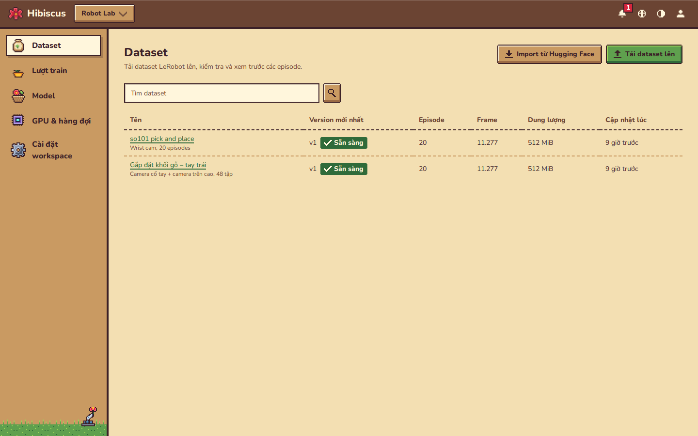
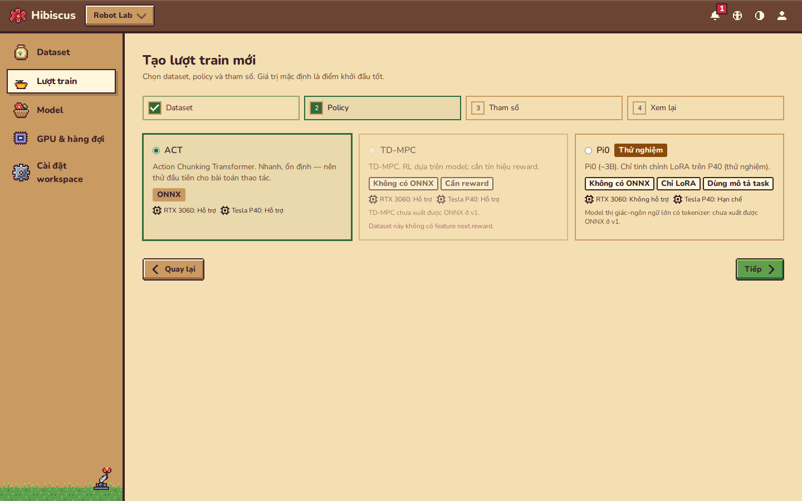
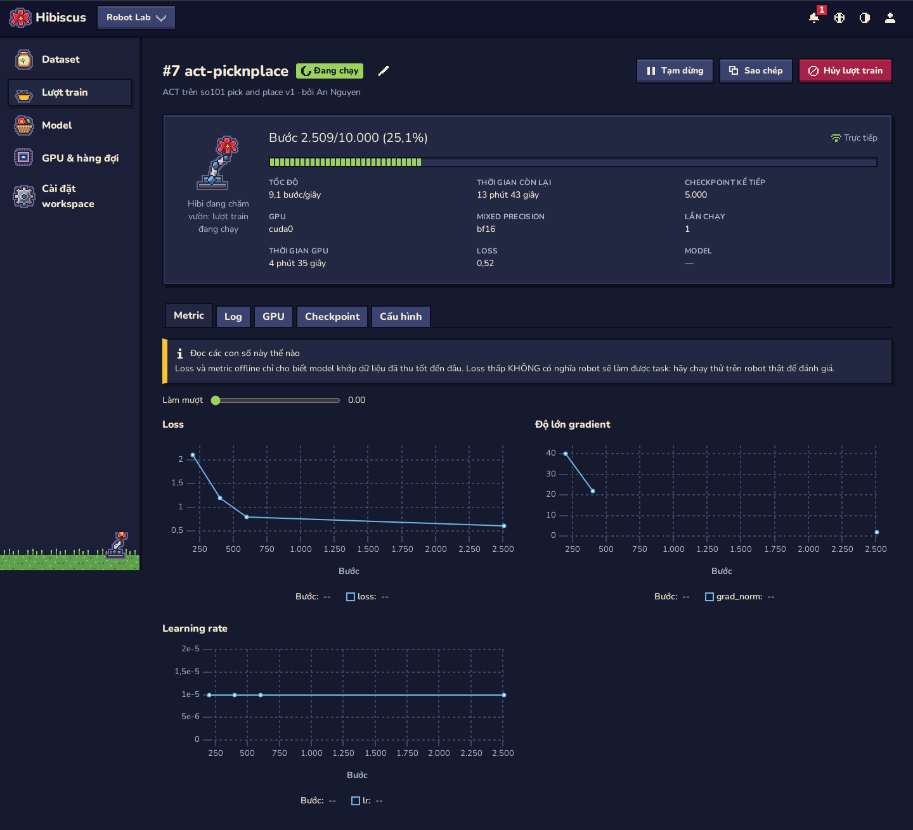
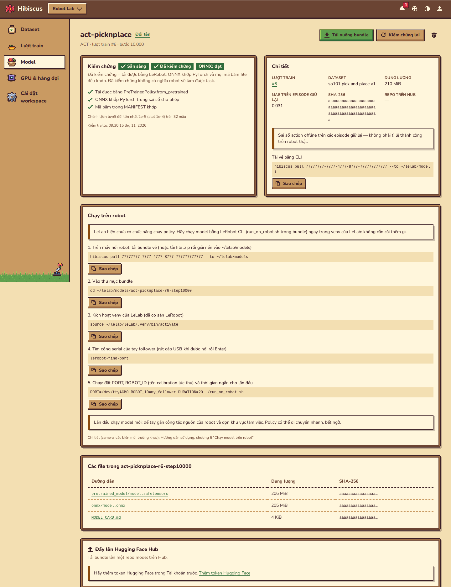
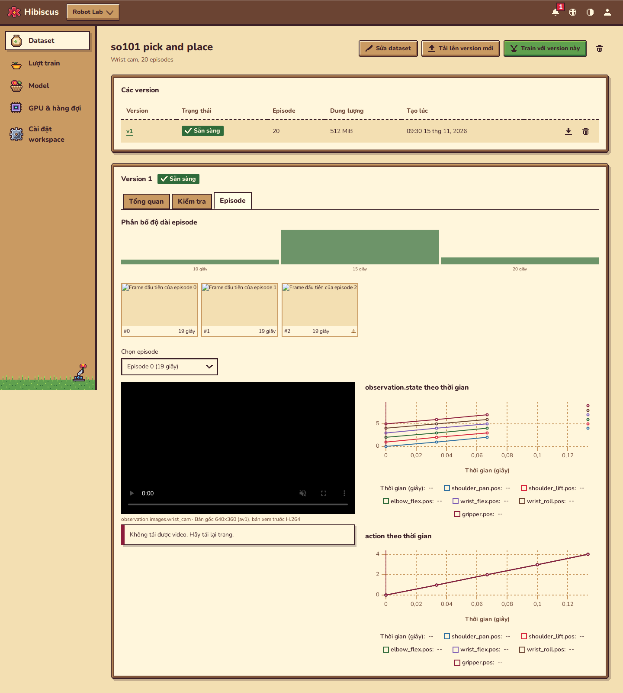
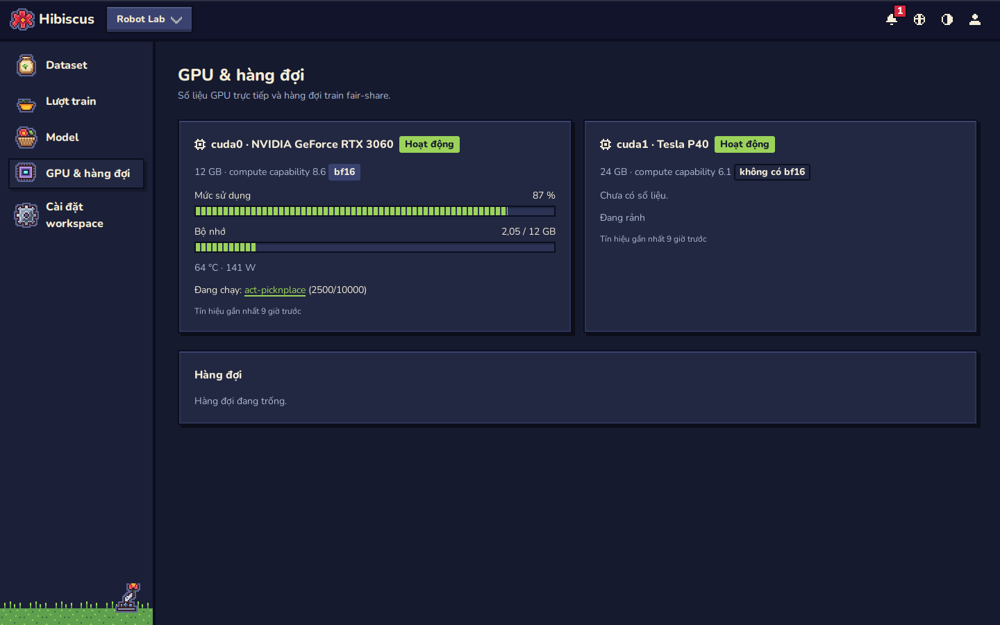
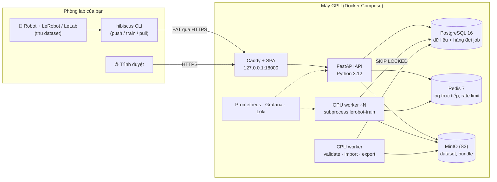
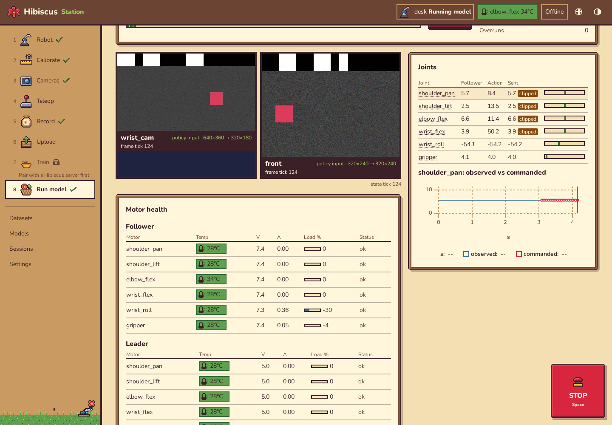

<div align="center">

<a href="https://github.com/Bigkatoan/Hibiscus">
  <picture>
    <source media="(prefers-color-scheme: dark)" srcset="assets/brand/banner-dark.png">
    <source media="(prefers-color-scheme: light)" srcset="assets/brand/banner-light.png">
    
  </picture>
</a>

[English](README.md) · **Tiếng Việt**

[](https://github.com/Bigkatoan/Hibiscus/actions/workflows/ci.yml)
[](https://github.com/Bigkatoan/Hibiscus/actions/workflows/codeql.yml)
[](LICENSE)
[](https://www.python.org/downloads/release/python-3120/)
[](https://github.com/Bigkatoan?tab=packages&repo_name=Hibiscus)
[](https://bigkatoan.github.io/Hibiscus/)
[](https://github.com/huggingface/lerobot)

</div>

**Hibiscus** là nền tảng tự host để train policy [LeRobot](https://github.com/huggingface/lerobot).
Bạn đẩy dataset vừa thu cạnh robot lên, chọn policy (ACT, Diffusion, SmolVLA, π0 …) qua wizard có
hướng dẫn, theo dõi quá trình train trực tiếp trên GPU của chính mình, rồi nhận về một **model bundle**
đã được kiểm chứng: thư mục `pretrained_model/` chuẩn LeRobot chạy được ngay bằng `lerobot-rollout`,
kèm bản ONNX, đánh giá offline và model card. Hibiscus làm cho cả team: workspace, chia GPU công bằng
(fair-share), 2FA và audit log có sẵn. Và nó khoác lên mình một khu vườn robot pixel-art, vì nhìn
loss giảm cũng nên vui như nhìn vườn cây lớn lên. 🌺

## Hình ảnh

<table>
  <tr>
    <td width="50%"><br><sub><b>Dataset</b>: upload resume được, kiểm tra sâu, xem trước</sub></td>
    <td width="50%"><br><sub><b>Wizard train</b>: dataset → policy → hyperparameter → xem lại</sub></td>
  </tr>
  <tr>
    <td width="50%"><br><sub><b>Run trực tiếp</b>: metrics qua SSE, nhiệt độ/VRAM GPU, log thô (giao diện đêm)</sub></td>
    <td width="50%"><br><sub><b>Thu hoạch</b>: bundle đã kiểm chứng, ONNX parity, đánh giá offline</sub></td>
  </tr>
  <tr>
    <td width="50%"><br><sub><b>Xem episode</b>: video + đồ thị từng khớp</sub></td>
    <td width="50%"><br><sub><b>Nhà kính</b>: GPU, hàng đợi và fair-share</sub></td>
  </tr>
</table>

Thêm ảnh (sáng, tối, điện thoại) trong [`docs/ux/screenshots/pixel/`](docs/ux/screenshots/pixel/).

## Bắt đầu nhanh

Cần một máy Linux có Docker Compose v2 và, để train, GPU NVIDIA cùng
[NVIDIA Container Toolkit](https://docs.nvidia.com/datacenter/cloud-native/container-toolkit/).

```bash
git clone https://github.com/Bigkatoan/Hibiscus.git && cd Hibiscus
cp deploy/.env.example deploy/.env && deploy/scripts/gen-secrets.sh >> deploy/.env   # rồi xem lại deploy/.env
docker compose -f deploy/docker-compose.yml up -d --build --wait
```

Mở <http://127.0.0.1:18000> và tạo tài khoản admin đầu tiên. Stack chỉ nghe trên loopback; muốn
truy cập từ máy khác thì đặt sau tunnel hoặc reverse proxy bạn chọn
([hướng dẫn cài đặt](docs/runbook/install.md), [Cloudflare Tunnel](docs/runbook/cloudflare.md)). File
compose mặc định chạy một worker cho mỗi GPU (`HIBISCUS_GPU0_DEVICE`, `HIBISCUS_GPU1_DEVICE`); xem
[GPU workers](docs/runbook/gpu.md) để chạy với một GPU hoặc tổ hợp card khác. `make help` liệt kê mọi
lệnh vận hành (backup, nâng cấp, log).

## Tính năng

| | |
|---|---|
| 🌱 **Dataset** | Upload chia chunk, resume được (thư mục, zip, tar, tar.zst, RAR5) từ trình duyệt hoặc CLI, import từ Hugging Face Hub, kiểm tra sâu định dạng LeRobot v3.0, version bất biến, xem trước episode với video và đồ thị khớp. |
| 🪴 **Train** | Wizard 4 bước, form sinh tự động từ config dataclass của chính LeRobot (LeRobot thêm tuỳ chọn mới là form tự có), preset, ước lượng VRAM/thời gian, kiểm tra trước khi chạy (camera key so với feature của policy), tạm dừng / chạy tiếp / huỷ / nhân bản run. |
| 📈 **Theo dõi trực tiếp** | Loss, L1, KLD, grad-norm, LR, throughput qua SSE; telemetry GPU qua NVML; log thô tìm kiếm được; phát hiện NaN / OOM / treo; so sánh nhiều run; thông báo qua email và webhook. |
| 🧺 **Model bundle** | Output nguyên bản của `lerobot-train` trong `pretrained_model/`, export ONNX kèm báo cáo parity, đánh giá offline trên episode giữ lại, `run_on_robot.sh` sinh sẵn, `MODEL_CARD.md`, `MANIFEST.json` có sha256, tuỳ chọn đẩy lên Hub. |
| 🏡 **Team** | Workspace, phân quyền RBAC, lời mời, personal access token có scope, hàng đợi GPU fair-share (Postgres `SKIP LOCKED`), quota theo người dùng. |
| 🔒 **Bảo mật** | Mật khẩu Argon2id, 2FA TOTP + mã khôi phục, quản lý phiên, audit log, giới hạn tần suất, mục tiêu OWASP ASVS L2; chính sách chỉ mở cổng loopback. |
| 🔭 **Vận hành** | Một file Docker Compose, dashboard Prometheus + Grafana + Loki, backup Postgres hằng đêm kèm diễn tập khôi phục, runbook nâng cấp. |
| 🤖 **Hibiscus Station** | App chạy cục bộ cạnh robot (`uvx hibiscus-station` hoặc `hibiscus station`): kết nối → hiệu chỉnh → camera → teleop → thu dataset LeRobot → upload → tải model về → chạy trên robot, có telemetry nhiệt độ / điện áp / dòng điện của động cơ, tự dừng khi quá nhiệt và xem camera trực tiếp. [Chi tiết bên dưới](#hibiscus-station). |
| 🧑‍🌾 **Song ngữ** | Tiếng Việt và tiếng Anh ở mọi màn hình, giao diện pixel-art dễ tiếp cận (WCAG 2.1 AA, chế độ ngày và đêm). |

## Policy được hỗ trợ

Hibiscus train bằng `lerobot-train` **nguyên bản** của LeRobot **0.7.1**, nên bundle hoạt động y hệt
checkpoint bạn tự train.

| Policy | Train | Export ONNX | Ghi chú |
|---|:-:|:-:|---|
| ACT | ✅ | ✅ đầy đủ | mặc định, nhanh; ~1,8 GB VRAM với batch 8 |
| Diffusion Policy | ✅ | ✅ UNet + vòng denoise trong `infer_onnx.py` | |
| VQ-BeT | ✅ | — | ONNX sẽ có sau |
| TD-MPC | ✅ | — | |
| SmolVLA | ✅ | — | ~450M tham số; bf16 trên Ampere trở lên, fp32 trên card cũ |
| π0 / π0.5 | ✅ LoRA/PEFT | — | ~3B tham số; cần ≥ 24 GB VRAM, UI chặn full fine-tune |

## Kiến trúc



Mọi quyết định kiến trúc được ghi thành ADR trong [`docs/adr/`](docs/adr/); contract HTTP là
[`api/openapi.yaml`](api/openapi.yaml) (OpenAPI 3.1), web client và CLI đều được sinh từ file này.

## CLI

CLI `hibiscus` chạy trên máy collect cạnh robot (Python ≥ 3.10, không cần torch hay LeRobot) và
nói chuyện với server bằng personal access token.

```bash
uv tool install ./cli                               # hoặc: pipx install ./cli
hibiscus login --server https://hibiscus.example.com  # dán token tạo ở Cài đặt → Token
hibiscus push ~/lerobot_data/so101_picknplace        # upload thư mục hoặc archive, resume được
hibiscus watch ~/lerobot_data                        # tự upload mỗi recording đã xong
hibiscus train -d so101_picknplace -p act --preset standard -f   # xếp hàng một run và theo dõi
hibiscus logs -f '#42'                               # log trực tiếp (SSE, tự nối lại)
hibiscus pull <model> --to ~/models                  # tải về + kiểm tra sha256 từng file
hibiscus station --mock                              # mở Hibiscus Station (tham số chuyển cho hibiscus-station)
```

Tài liệu đầy đủ: [`cli/README.md`](cli/README.md).

## Model bundle và chạy trên robot

```
so101_picknplace_act-r42-step100000/
├── pretrained_model/        # output chuẩn LeRobot → --policy.path
├── onnx/                    # model.onnx, io_spec.json, normalization.json, parity_report.json, infer_onnx.py
├── eval/                    # metrics offline trên episode giữ lại + đồ thị
├── logs/                    # train.log, metrics.csv
├── run_on_robot.sh          # lệnh lerobot-rollout điền sẵn từ dataset của bạn
├── MODEL_CARD.md
└── MANIFEST.json            # sha256 mọi file, version phần mềm, dataset@version
```

Bundle chỉ được đánh dấu **verified** khi load được bằng `PreTrainedPolicy.from_pretrained`, ONNX đạt
kiểm tra parity và hash trong manifest khớp. Để chạy, dùng bất kỳ môi trường nào đã cài LeRobot 0.7.1
(ví dụ venv của LeLab):

```bash
hibiscus pull so101_picknplace_act --to ~/models && cd ~/models/so101_picknplace_act-r42-step100000
source ~/lelab/leLab/.venv/bin/activate            # venv bất kỳ có lerobot==0.7.1
PORT=/dev/ttyACM0 ROBOT_ID=my_follower WRIST_CAM=0 DURATION=20 ./run_on_robot.sh
```

`run_on_robot.sh` bọc lệnh `lerobot-rollout --policy.path=./pretrained_model` với robot type, fps, tên
camera và task lấy từ dataset, bạn chỉ cần điền cổng. Lần đầu hãy để tay gần công tắc nguồn. Chi tiết:
[Chạy model trên robot](docs/user-guide/vi/06-chay-tren-robot.md).

## Hibiscus Station

Hibiscus Station là nửa phía robot của Hibiscus: một web app nhỏ chạy cục bộ (FastAPI trên loopback,
cùng giao diện pixel) trên máy nối với robot, gom cả vòng làm việc vào một chỗ.

<p align="center"><br><sub><b>Chạy model</b>: camera trực tiếp và telemetry từng động cơ khi policy điều khiển cánh tay</sub></p>

1. **Kết nối** cánh tay follower và leader SO-100 / SO-101 (tự dò cổng serial).
2. **Hiệu chỉnh** (calibrate) động cơ, rồi cài đặt và xem trước **camera**.
3. **Teleop** và **thu** dataset LeRobot v3.0 theo từng episode.
4. **Upload** lên server Hibiscus, train ở đó, rồi **tải** model bundle đã kiểm chứng về.
5. **Chạy** model trên robot, xem camera trực tiếp.

Trong suốt quá trình, Station hiển thị nhiệt độ, điện áp và dòng điện của động cơ và **tự dừng cánh
tay** khi một động cơ quá nhiệt.

```bash
uvx hibiscus-station                 # không cần cài; hoặc: uv tool install hibiscus-station
hibiscus station --mock --no-browser # qua CLI, ở đây với phần cứng giả lập
```

> **Trạng thái:** Hibiscus Station đã được kiểm thử end-to-end với phần cứng giả lập (mock) và một
> checkpoint ACT thật. Station **chưa được kiểm chứng trên phần cứng SO-101 thật**, nên hãy coi đây là
> bản xem trước và để tay gần công tắc nguồn.

Đặc tả: [`docs/spec/station.md`](docs/spec/station.md) · cách dùng và phát triển: [`station/README.md`](station/README.md).

## Tài liệu

* 📘 **Trang tài liệu**: <https://bigkatoan.github.io/Hibiscus/> (Tiếng Việt + English)
* Hướng dẫn sử dụng: [Tiếng Việt](docs/user-guide/vi/01-bat-dau.md) · [English](docs/user-guide/en/01-getting-started.md)
* Runbook tự host: [`docs/runbook/`](docs/runbook/README.md)
* Đặc tả: [định dạng bundle](docs/spec/bundle.md), [vòng đời run](docs/spec/run-lifecycle.md), [schema policy](docs/spec/policy-schema.md), [Hibiscus Station](docs/spec/station.md)

## Lộ trình

- [x] **v0.1 Hibiscus Trainer**: dataset, train, metrics trực tiếp, bundle, team, CLI, giao diện pixel
- [x] **Hibiscus Station** (bản xem trước): cài đặt robot, hiệu chỉnh (calibration) động cơ, camera,
      teleop và thu dataset ngay trong giao diện pixel, upload / tải model, chạy policy với telemetry
      động cơ, tự dừng khi quá nhiệt và camera trực tiếp ([chi tiết](#hibiscus-station))
- [ ] 🚧 Kiểm chứng Hibiscus Station trên phần cứng SO-101 thật (hiện tại: phần cứng giả lập + checkpoint ACT thật)
- [ ] Export ONNX cho VQ-BeT, engine TensorRT / Jetson
- [ ] Đăng nhập SSO / OIDC
- [ ] Đánh giá trong mô phỏng

Xem [changelog](CHANGELOG.md) để biết những gì đã phát hành.

## Đóng góp

Mọi đóng góp đều được chào đón: báo lỗi, dịch thuật, pixel art, tài liệu và code. Bắt đầu từ
[CONTRIBUTING.md](CONTRIBUTING.md) (cài môi trường dev, test, quy ước commit) và
[Quy tắc ứng xử](CODE_OF_CONDUCT.md). Câu hỏi xin gửi vào
[GitHub Discussions](https://github.com/Bigkatoan/Hibiscus/discussions).

## Bảo mật

Vui lòng **không** mở issue công khai cho lỗ hổng bảo mật. Hãy báo riêng qua
[GitHub Security Advisories](https://github.com/Bigkatoan/Hibiscus/security/advisories/new); xem
[SECURITY.md](SECURITY.md).

## Trích dẫn

Nếu Hibiscus giúp ích cho nghiên cứu của bạn, xin trích dẫn (nút *Cite this repository* của GitHub
đọc [`CITATION.cff`](CITATION.cff)):

```bibtex
@software{hibiscus2026,
  title  = {Hibiscus: a self-hosted training platform for LeRobot policies},
  author = {{Bigkatoan and the Hibiscus contributors}},
  year   = {2026},
  url    = {https://github.com/Bigkatoan/Hibiscus},
  license = {AGPL-3.0-only}
}
```

## Giấy phép

Hibiscus là phần mềm tự do theo [GNU Affero General Public License v3.0](LICENSE). Nếu bạn chạy một
phiên bản đã sửa đổi như một dịch vụ mạng, AGPL yêu cầu bạn cung cấp mã nguồn cho người dùng của dịch
vụ đó. Pixel art, linh vật Hibi, logo hoa dâm bụt, icon và ảnh thương hiệu **không** thuộc AGPL: chúng
là © Bigkatoan, giữ mọi quyền; được dùng nguyên vẹn để chạy và phân phối lại chính Hibiscus, còn bản
fork không được dùng làm thương hiệu riêng. Xem [ASSETS-LICENSE](ASSETS-LICENSE). Font Nunito đi kèm
theo SIL Open Font License (`frontend/public/fonts/OFL-Nunito.txt`).

## Lời cảm ơn

* [**LeRobot**](https://github.com/huggingface/lerobot) của Hugging Face: Hibiscus train, export và
  chạy policy của LeRobot mà không sửa đổi gì.
* [**LeLab**](https://github.com/nicolas-rabault/leLab) (MIT): giao diện web thân thiện cho LeRobot,
  nguồn cảm hứng thiết kế của dự án và là môi trường mà bundle được làm để chạy cùng.
* Pixel art, linh vật Hibi (cánh tay robot cầm hoa dâm bụt) và icon lấy từ bộ thiết kế Hibiscus:
  hình gốc vẽ bằng code cho dự án này, không dùng tài nguyên của bên thứ ba
  ([ASSETS-LICENSE](ASSETS-LICENSE)).

<div align="center"><sub>Trồng bằng 🌺 bởi những người đóng góp cho Hibiscus</sub></div>
