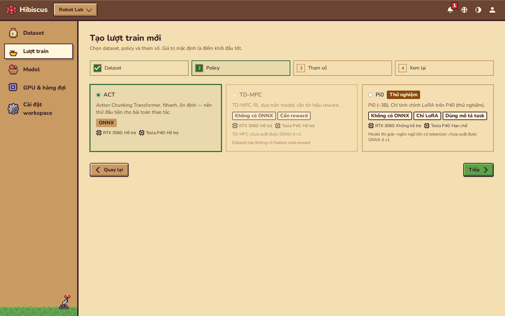
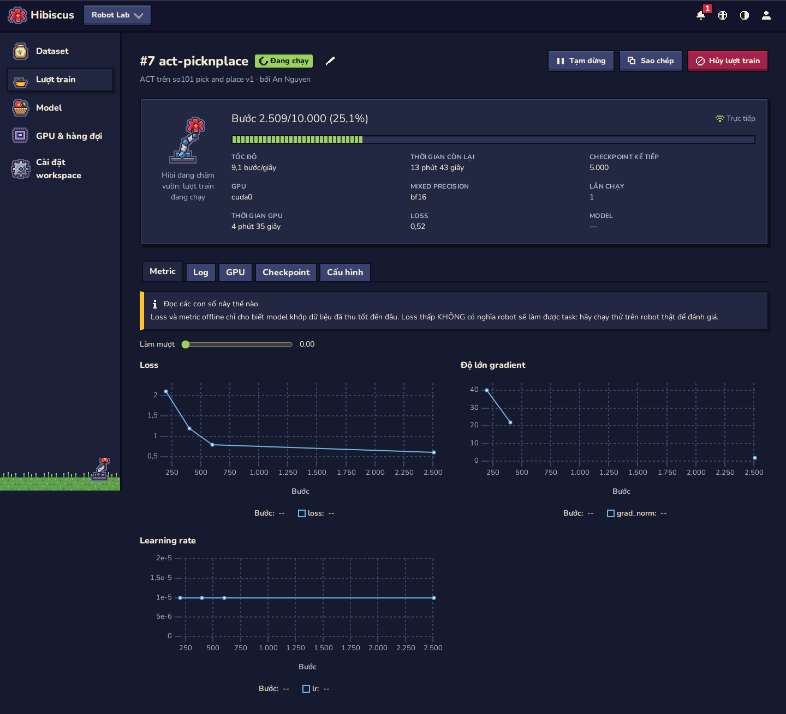

---
hide:
  - navigation
  - toc
---

# Hibiscus { .hb-sr-only }

<div class="hb-hero" markdown>


**Train LeRobot policies on your own GPUs, and grow them into robot-ready model bundles.**

[Get started :material-sprout:](user-guide/en/01-getting-started.md){ .md-button .md-button--primary }
[Bắt đầu (Tiếng Việt)](user-guide/vi/01-bat-dau.md){ .md-button }
[Self-host it](runbook/install.md){ .md-button }

</div>

Hibiscus is a self-hosted training platform for [LeRobot](https://github.com/huggingface/lerobot)
policies. Push the datasets you recorded next to your robot, pick a policy in a guided wizard,
watch the run live, and download a verified bundle that runs with `lerobot-rollout` straight away.

<div class="grid cards" markdown>

-   :material-seed-outline: **Datasets**

    ---

    Resumable upload from the browser or the `hibiscus` CLI, deep LeRobot v3.0 validation, episode
    preview with video and joint plots.

    [:octicons-arrow-right-24: Datasets](user-guide/en/02-datasets.md)

-   :material-sprout: **Training**

    ---

    ACT, Diffusion, VQ-BeT, TD-MPC, SmolVLA and π0 with forms generated from LeRobot itself,
    fair-share GPU queue, live metrics over SSE.

    [:octicons-arrow-right-24: Training](user-guide/en/04-training.md)

-   :material-basket-outline: **Model bundles**

    ---

    Standard `pretrained_model/`, ONNX with parity report, offline evaluation and a generated
    `run_on_robot.sh`.

    [:octicons-arrow-right-24: Bundle format](spec/bundle.md)

-   :material-robot-industrial-outline: **Run on the robot**

    ---

    Pull the bundle next to your robot and run it inside any LeRobot 0.7.1 environment, such as your
    LeLab virtualenv.

    [:octicons-arrow-right-24: Running on the robot](user-guide/en/06-run-on-robot.md)

</div>

## Quick start

```bash
git clone https://github.com/Bigkatoan/Hibiscus.git && cd Hibiscus
cp deploy/.env.example deploy/.env && deploy/scripts/gen-secrets.sh >> deploy/.env   # then review deploy/.env
docker compose -f deploy/docker-compose.yml up -d --build --wait
```

Then open <http://127.0.0.1:18000>. The [install guide](runbook/install.md) covers GPUs, tunnels
and the first admin account.

## A peek at the garden

<div class="grid" markdown>





</div>

!!! tip "Hibiscus Station"
    The robot-side app (robot setup, motor calibration, teleoperation, dataset recording and running
    a policy with live motor temperatures and camera feeds) lives in its own repository,
    [Bigkatoan/hibiscus-station](https://github.com/Bigkatoan/hibiscus-station).
